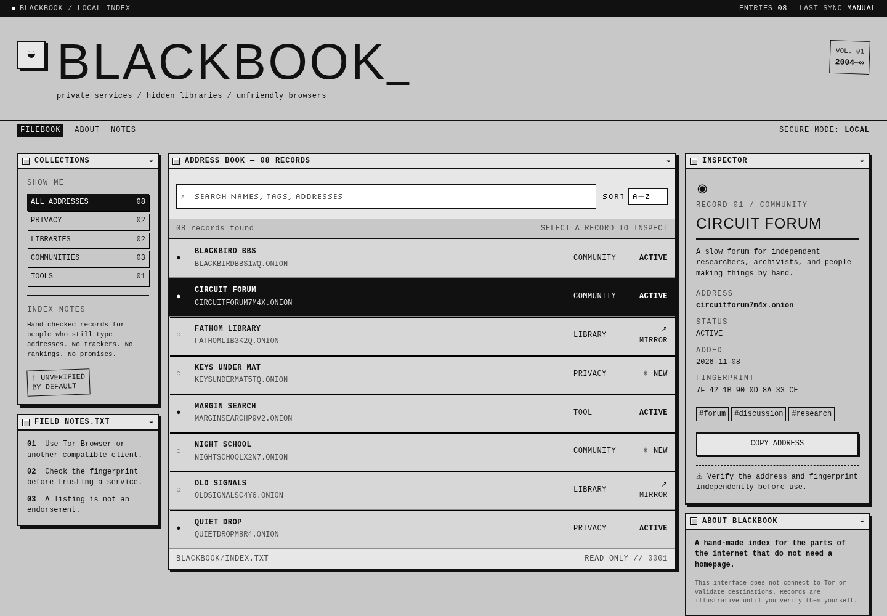

# BLACKBOOK



BLACKBOOK is a hand-coded, monochrome address book for the small web: private services, hidden libraries, communities, and tools for people who still type addresses.

It is intentionally plain. No accounts, no analytics, no feed, no ranking system. The included `.onion` records are synthetic examples and are marked unverified; this interface does not connect to Tor or validate destinations.

## What is here

- Macintosh-inspired window chrome with brutalist borders and dither texture.
- Searchable, sortable records with collection filters.
- Record inspector with category, status, date, tags, and fingerprint fields.
- Compartmented contact envelopes: a disposable alias, handoff rule, and local trace budget for network, metadata, and social exposure.
- Copy-address action with local-only behavior.
- Responsive layout for desktop and narrow screens.
- A standalone Linux launcher that does not use Electron.

## Launch as an app

The recommended launcher starts a loopback-only Python server and opens the UI in a dedicated Chromium app window. The server stops when the app window closes.

```bash
./blackbook-launcher.py
```

The launcher accepts Chromium, Chromium Browser, Google Chrome, or Chrome when available. It stores its dedicated browser profile under `$XDG_STATE_HOME/blackbook/` (or `~/.local/state/blackbook/`).

To add BLACKBOOK to the Linux application menu:

```bash
mkdir -p ~/.local/share/applications
cp blackbook.desktop ~/.local/share/applications/blackbook.desktop
```

See [LAUNCH.md](LAUNCH.md) for the short launch note.

## Run as a static site

The interface is still plain HTML, CSS, and JavaScript with no build step:

```bash
python3 -m http.server 8097
```

Then open <http://127.0.0.1:8097/>. The existing Node server remains available with `npm install && npm start` for the broader Underweb pages.

## Project map

| file | purpose |
| --- | --- |
| `index.html` | BLACKBOOK address-book surface |
| `addressbook.js` | records, filtering, sorting, selection, copy action |
| `style.css` | shared legacy Underweb styles plus the BLACKBOOK monochrome theme |
| `blackbook-launcher.py` | non-Electron Linux app launcher |
| `blackbook.desktop` | application-menu entry |
| `LAUNCH.md` | launcher instructions |
| `docs/assets/blackbook-ui.png` | UI preview |

The older Underweb directory pages remain in the repository for reference and existing content workflows.

## Safety note

An address-book listing is not an endorsement. Verify every destination and fingerprint independently, and use a compatible privacy browser when accessing real onion services. The contact envelope is a planning aid, not a guarantee of anonymity: it generates an in-memory alias token, does not persist identity data, and cannot defeat browser, device, network, or behavioral fingerprinting by itself.
